# You Glow Cebu — System Process Flow

This document separates the current system into clear business modules and shows how a customer order moves from product selection to completion.

## 1. Complete transaction flow

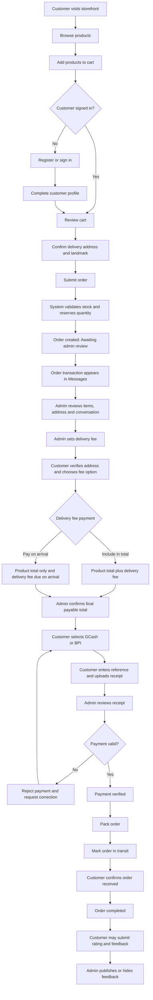

## 2. Customer account module

**Purpose:** Customer identity, profile, saved delivery details and secure access.

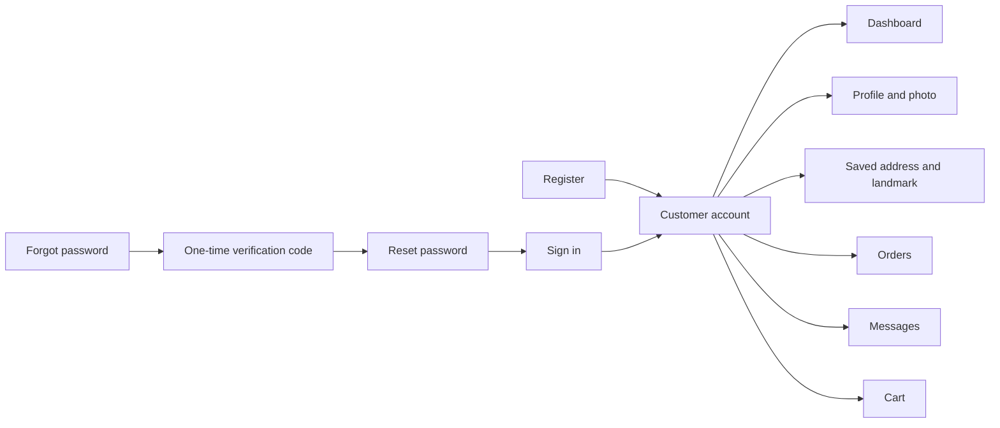

Main responsibilities:

- Register, sign in, sign out and reset a forgotten password.
- Maintain name, email, phone number, profile picture, address and landmark.
- View only the signed-in customer's orders, messages, receipts and feedback.

## 3. Product and cart module

**Purpose:** Display active products and prepare an order before checkout.

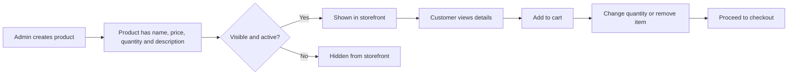

The server rechecks product availability during checkout. The cart alone does not reserve stock.

## 4. Checkout and stock reservation module

**Purpose:** Create a valid order and prevent overselling.

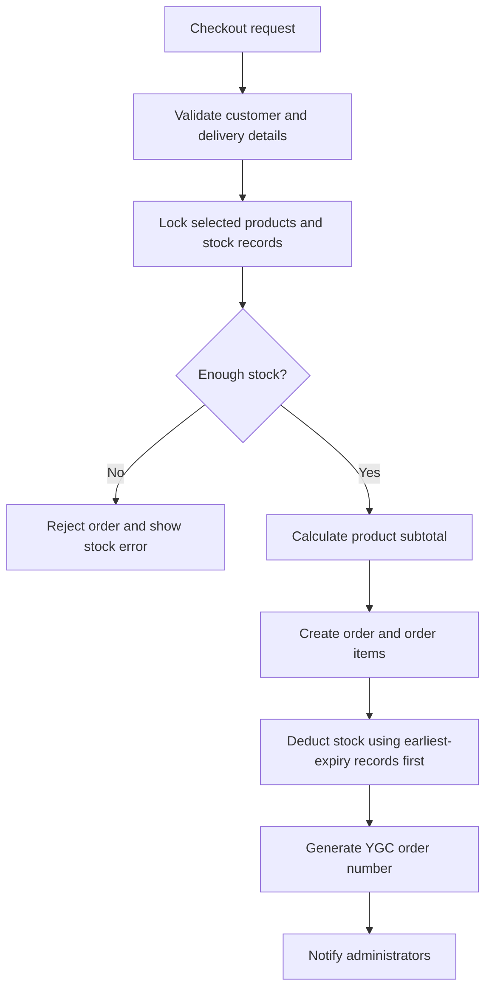

The initial workflow status is `awaiting_admin_review`. Payment is not collected during initial checkout.

## 5. Message transaction module

**Purpose:** Keep the order discussion and transaction actions in one chronological conversation.

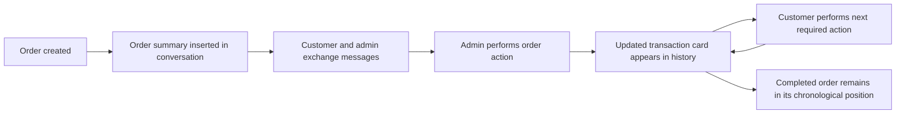

Messages may include text, links and supported image attachments. Order actions remain controlled by the order workflow; a normal chat message cannot change an order status.

## 6. Delivery fee and final-total module

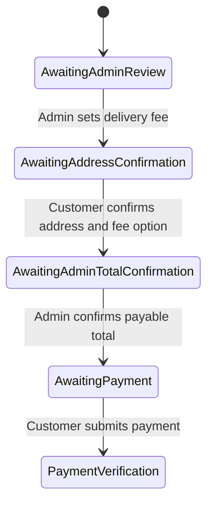

Fee options:

- **Included in total:** payable amount = product subtotal − discount + delivery fee.
- **Pay on arrival:** online payable amount = product subtotal − discount; delivery fee remains due to the delivery personnel.

## 7. Payment module

**Purpose:** Configure payment methods and verify customer payments.

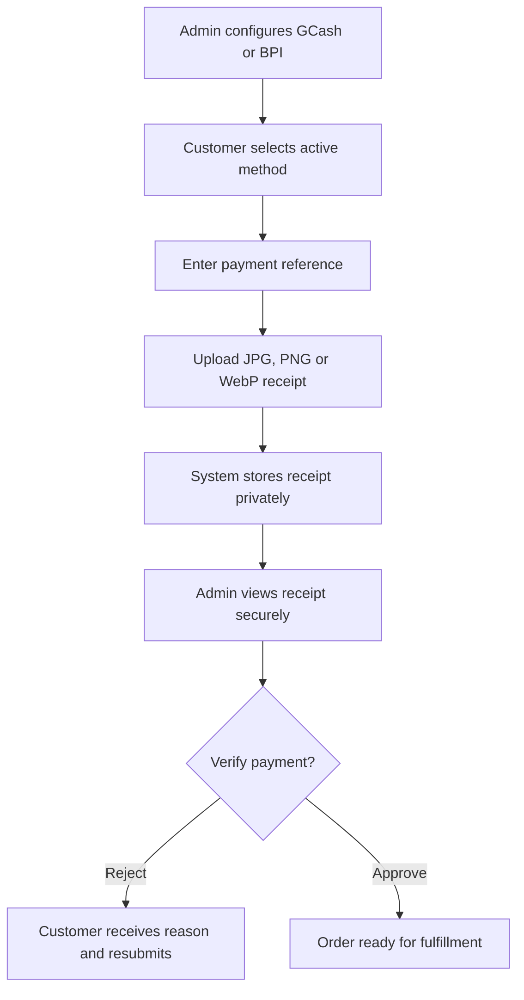

Receipts are protected files and are available only to the related customer and authorized administrators.

## 8. Order fulfillment module

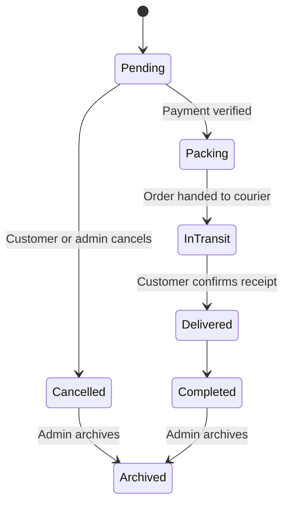

Rules:

- Customers may cancel only while an order is still pending.
- Cancelling a pending order restores its reserved quantities to inventory and adds a message to the conversation.
- Permanent deletion is limited to cancelled or archived orders and requires confirmation.

## 9. Inventory module

**Purpose:** Track quantities, low stock and expiry details separately from the product catalog.

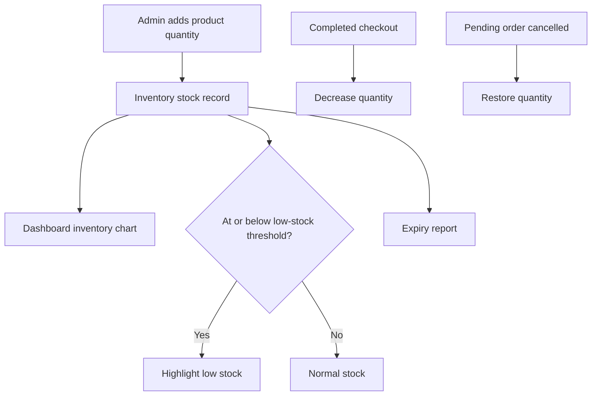

## 10. Discounts module

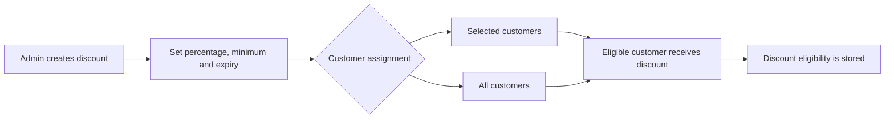

The discount administration and customer-assignment functions are implemented. The current server checkout still creates orders with `discount_amount` set to zero, so automatic application of an assigned discount to checkout totals requires a separate implementation step.

## 11. Customer feedback module

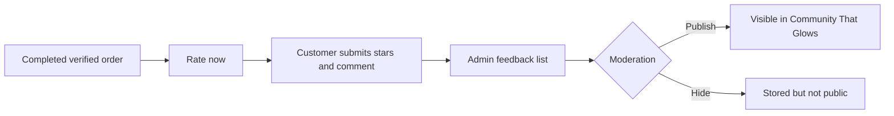

Only feedback connected to a completed customer order should be treated as verified-order feedback.

## 12. Admin modules

| Module | Primary responsibility |
|---|---|
| Dashboard | Net product revenue, order counts, top-selling product, active customers, sales graph, inventory chart and feedback |
| Products | Create, edit, hide and delete storefront products |
| Orders | Review details, update fulfillment, archive and safely delete eligible orders |
| Inventory | Manage quantities, low-stock thresholds and expiry records |
| Customers | View customer profiles without granting administrator access |
| Messages | Handle the shared customer-support and order-transaction inbox |
| Discounts | Create discounts and assign them to selected or all customers |
| Reports | Generate date-filtered sales, product, order, inventory and expiry reports |
| Payments | Configure active GCash and BPI account or QR information |
| Feedback | Publish or hide verified customer ratings and comments |
| Admins | Add and maintain administrator accounts separately from customers |

## 13. Reports module

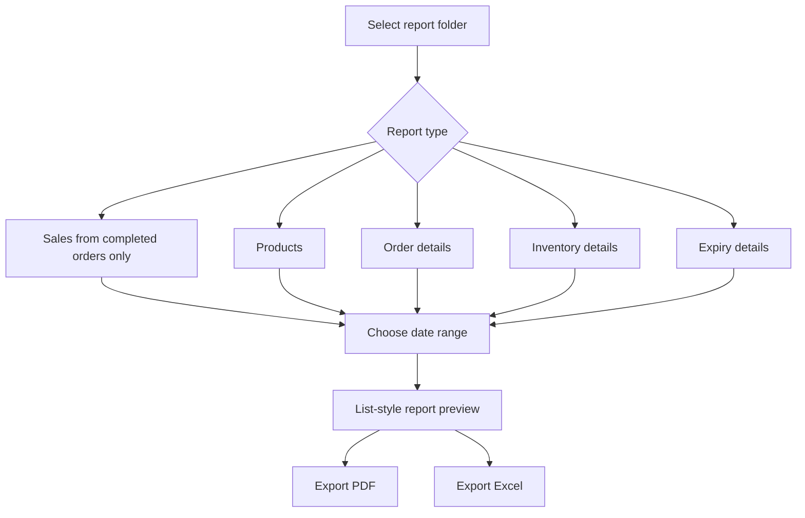

Sales revenue excludes delivery fees.

## 14. Email notification module

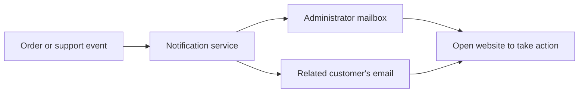

Email notifications alert users to activity; private order, receipt and message details remain inside the authenticated website.

## 15. Module boundaries

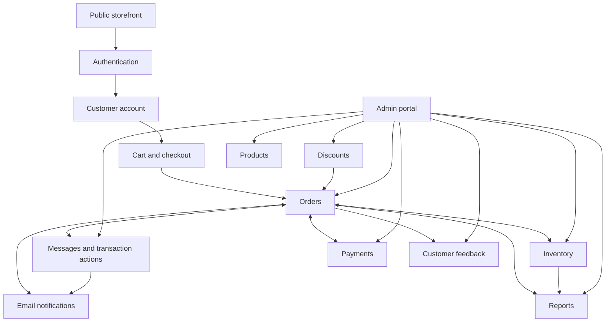

Each module has one main responsibility. Cross-module changes should occur through the existing controllers and services so that authorization, stock restoration, private file access and notifications remain consistent.
